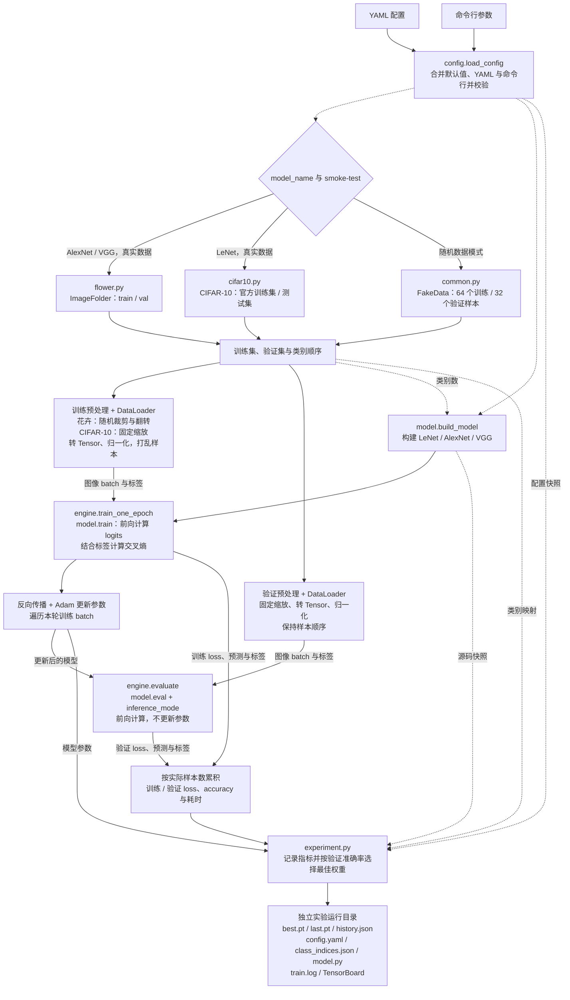
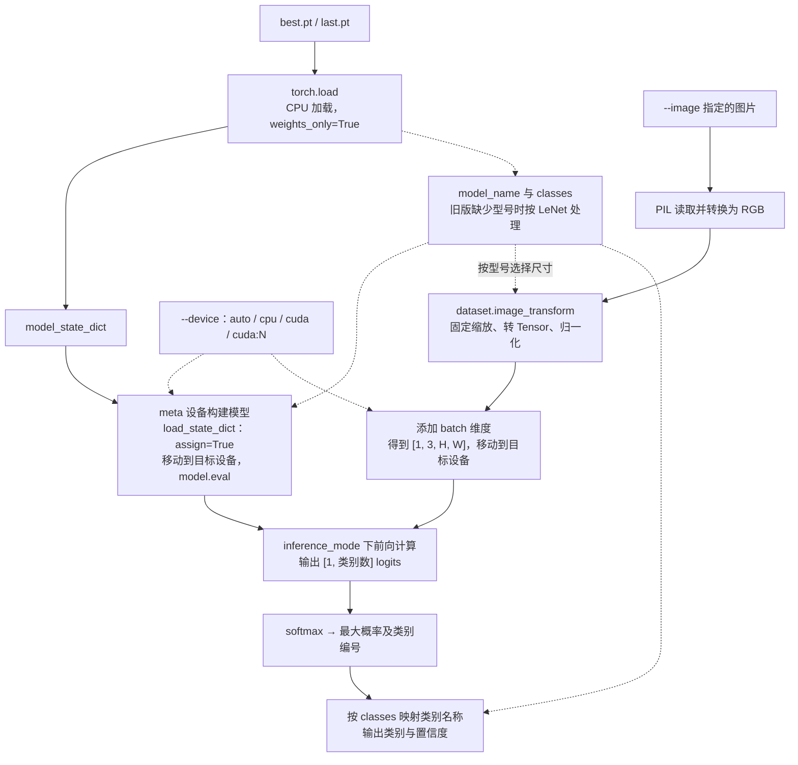
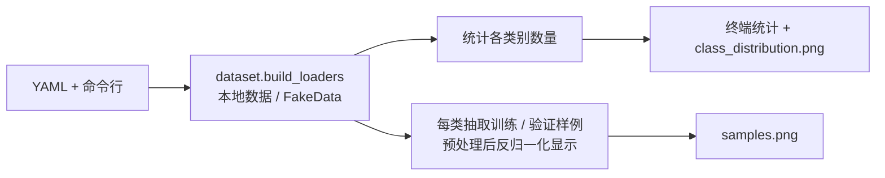

# PyTorch 图像分类实验：LeNet、AlexNet 与 VGG

面向学习与本地实验的图像分类项目，使用原生 PyTorch 实现数据预览、训练、验证、权重保存和单图预测。默认采用 AlexNet 进行花卉分类，也支持 LeNet / CIFAR-10，以及 VGG11、VGG13、VGG16、VGG19 / 花卉分类。

项目直接从源码运行，以 YAML 管理配置，将日志、指标、权重和配置快照集中归档，便于阅读实现和比较实验。

## 目录

- [功能与模型](#功能与模型)
- [环境安装](#环境安装)
- [快速开始](#快速开始)
- [数据准备与预览](#数据准备与预览)
- [模型训练](#模型训练)
- [单图预测](#单图预测)
- [配置与命令行](#配置与命令行)
- [实验结果与 TensorBoard](#实验结果与-tensorboard)
- [数据流图](#数据流图)
- [项目结构与实现](#项目结构与实现)
- [开发与检查](#开发与检查)
- [常见问题](#常见问题)
- [参考资料](#参考资料)

## 功能与模型

| 模型 | `model_name` | 配套数据 | 输入形状 | 配置文件 |
| --- | --- | --- | --- | --- |
| LeNet | `lenet` | CIFAR-10，10 类 | `[N, 3, 32, 32]` | `config/lenet.yaml` |
| AlexNet | `alexnet` | 花卉，默认 5 类 | `[N, 3, 224, 224]` | `config/alexnet.yaml` |
| VGG | `vgg11`、`vgg13`、`vgg16`、`vgg19` | 花卉，默认 5 类 | `[N, 3, 224, 224]` | `config/vgg16.yaml`，其他型号修改配置 |

- 从头训练，使用交叉熵损失与 Adam 优化器，不自动下载预训练权重。
- 支持 CPU 或单张 CUDA GPU，可显式选择可见设备编号。
- 支持本地真实数据，以及无需下载数据的随机图像流程验证。
- 提供类别数量统计、预处理后的样例图和 TensorBoard 曲线。
- 每次运行分别保存配置、模型源码、类别映射、日志、历史指标与最佳 / 最后权重。

AlexNet 和 VGG 根据实际数据集确定输出类别数；LeNet 固定用于 CIFAR-10 十分类。

## 环境安装

开发基线为 **Python 3.12**，核心依赖固定为 **PyTorch 2.8.0**、**torchvision 0.23.0**。完整版本约束见 `requirements.txt`。

以下命令均在项目根目录执行。建议使用独立虚拟环境，例如在 Linux / macOS 下：

```bash
python3.12 -m venv .venv
source .venv/bin/activate
python -m pip install -r requirements.txt
```

也可使用自行创建的 Conda 环境，无需依赖特定环境名称。Windows PowerShell 下使用 `.venv\Scripts\Activate.ps1` 激活虚拟环境；下文的多行命令使用 Bash 语法，其他终端可合并为单行执行。

检查解释器、依赖及 CUDA 可用性：

```bash
python --version
python -c "import torch, torchvision; print('torch:', torch.__version__); print('torchvision:', torchvision.__version__); print('CUDA:', torch.cuda.is_available())"
```

CUDA 是否可用取决于 PyTorch 安装构建、GPU 和驱动环境；没有可用 CUDA 时可使用 `--device cpu`。VS Code 调试使用编辑器中选定的 Python 解释器。

## 快速开始

### 1. 无需数据集验证流程

先使用规模较小的 LeNet 在 CPU 上运行：

```bash
python train.py \
  --config config/lenet.yaml \
  --smoke-test \
  --device cpu \
  --experiment-name lenet_smoke
```

`--smoke-test` 使用 64 张随机训练图像与 32 张随机验证图像，默认运行 1 轮；显式传入 `--epochs` 可覆盖轮数。命令执行训练、验证、日志记录与权重保存，终端最后打印结果目录。

随机图像的准确率与预测结果仅用于验证程序流程，不能用于判断模型效果。

### 2. 加载本次生成的权重

将以下示例运行时间替换为上一步输出的实际目录名：

```bash
python predict.py \
  --checkpoint outputs/lenet_smoke/20261019_143000_123456/best.pt \
  --image asserts/images/cat.jpg \
  --device cpu
```

加载随机数据训练的权重时，程序会打印 `SMOKE TEST` 提示。

### 3. 使用真实数据

按下一节准备本地数据后，选择配置启动训练：

```bash
python train.py --config config/alexnet.yaml --device auto
```

`python -m train` 与 `python train.py` 等价；预测也可使用 `python -m predict`。

## 数据准备与预览

程序仅加载本地数据，**不会自动下载或划分数据集**。训练集与验证集必须提前准备。

### 花卉数据：AlexNet / VGG

默认目录为 `dataset/data/flower_data`：

```text
dataset/data/flower_data/
├── train/
│   ├── daisy/
│   ├── dandelion/
│   ├── roses/
│   ├── sunflowers/
│   └── tulips/
└── val/
    ├── daisy/
    ├── dandelion/
    ├── roses/
    ├── sunflowers/
    └── tulips/
```

每个类别目录存放相应图片。程序使用 `ImageFolder` 读取 `train` 和 `val`，按类别目录名排序生成编号，并要求两者的类别及编号一致。根目录下的原始图片备份和压缩包不会参与训练。

默认花卉类别为 `daisy`、`dandelion`、`roses`、`sunflowers`、`tulips`。真实数据也可使用其他类别目录，模型输出类别数会随之调整；随机数据模式始终使用上述五类名称。

数据位于其他位置时，指定包含 `train`、`val` 的父目录：

```bash
python train.py --config config/alexnet.yaml --data-dir /path/to/flower_data --device auto
```

花卉数据只使用训练集和验证集，没有额外的独立测试集入口。

### CIFAR-10：LeNet

将完整的 CIFAR-10 Python 版本解压到以下位置：

```text
dataset/data/
└── cifar-10-batches-py/
    ├── batches.meta
    ├── data_batch_1
    ├── data_batch_2
    ├── data_batch_3
    ├── data_batch_4
    ├── data_batch_5
    └── test_batch
```

`data_dir` 应指向 `cifar-10-batches-py` 的父目录，默认是 `dataset/data`。类别顺序为 `airplane`、`automobile`、`bird`、`cat`、`deer`、`dog`、`frog`、`horse`、`ship`、`truck`。

当前实现将官方训练集用于训练，**将官方测试集用于每轮验证和最佳权重选择**。因此，这里的验证指标不能同时作为独立测试集上的最终评估结果。

### 图像预处理

| 数据方案 | 训练 | 验证与预测 |
| --- | --- | --- |
| 花卉 | 随机裁剪并缩放到 `224×224`，随机水平翻转 | 固定缩放到 `224×224` |
| CIFAR-10 | 固定缩放到 `32×32` | 固定缩放到 `32×32` |

所有输入均使用三通道 RGB、`ToTensor()` 和归一化，均值与标准差均为 `(0.5, 0.5, 0.5)`。验证和单图预测共用同一套预处理。

### 数据预览

```bash
# 花卉数据：AlexNet 为默认配置
python -m dataset --config config/alexnet.yaml --device cpu

# CIFAR-10
python -m dataset --config config/lenet.yaml --device cpu

# VGG
python -m dataset --config config/vgg16.yaml --device cpu

# 无需真实数据的预览验证
python -m dataset --config config/lenet.yaml --smoke-test --device cpu
```

预览会在终端输出类别数量，并保存到 `outputs/<实验名称>/dataset_preview/`：

- `samples.png`：每类一张训练样例和一张验证样例，展示预处理后的图像。
- `class_distribution.png`：训练集与验证集的类别数量分布。

生成图片后程序直接退出，打开终端输出的 PNG 路径即可查看，WSL / SSH 无需配置显示服务或额外参数。预览目录不包含运行时间，同一实验再次预览时会覆盖这两张图片。

## 模型训练

### 常用命令

```bash
# AlexNet / 花卉
python train.py --config config/alexnet.yaml --device auto

# LeNet / CIFAR-10
python train.py --config config/lenet.yaml --device auto

# VGG16 / 花卉
python train.py --config config/vgg16.yaml --device auto

# 覆盖实验名称、训练轮数、batch size 和学习率
python train.py \
  --config config/alexnet.yaml \
  --experiment-name alexnet_baseline \
  --epochs 20 \
  --batch-size 16 \
  --lr 0.0001 \
  --device auto
```

训练时，每轮先训练再验证。损失和准确率按实际样本数统计，最后一个不足完整 batch 的批次也按实际数量加权。最佳权重依据验证准确率选择；准确率相同时保留先前的最佳权重。

### VGG 使用说明

提供的 `config/vgg16.yaml` 使用 30 轮训练、学习率 `0.0001`、batch size 2 和 `auto` 设备。需要其他 VGG 型号时，复制该文件，并修改 `model_name` 与 `experiment_name`，例如：

```yaml
model_name: vgg11
experiment_name: vgg11_flowers
```

VGG 实现采用无 BatchNorm 的标准结构：五个卷积阶段、五次池化，分类器为 `25088 → 4096 → 4096 → 类别数`，两个 Dropout 的概率均为 `0.5`。训练显式初始化采用 Xavier uniform，偏置置零。

五分类 VGG16 有 **134,281,029 个参数**，仅 float32 权重约占 **512 MiB**。全参数 Adam 训练中，权重、梯度及两份优化器状态合计约 **2 GiB**，还需额外容纳中间激活和运算空间；保存的 `best.pt` 与 `last.pt` 也各包含一份模型权重。

减小 batch 可以降低激活占用，但不能消除参数和优化器状态的固定占用。在资源充足的设备上可执行以下流程验证：

```bash
python train.py \
  --config config/vgg16.yaml \
  --smoke-test \
  --batch-size 1 \
  --device auto
```

此命令仍训练完整 VGG，并遍历 64 张训练图像与 32 张验证图像，CPU 上可能耗时较长。默认训练入口不包含冻结层、混合精度或梯度累积选项。

## 单图预测

使用某次运行生成的 `best.pt` 或 `last.pt`：

```bash
python predict.py \
  --checkpoint /path/to/run/best.pt \
  --image /path/to/flower.jpg \
  --device auto
```

输出格式示例，具体类别与置信度由权重及输入决定：

```text
模型：vgg16；设备：cuda:0
预测类别：sunflowers；置信度：62.58%
```

预测会从 checkpoint 读取模型型号和类别顺序，自动选择对应预处理，无需额外传入训练 YAML。输入会转换为 RGB，支持灰度图和带透明通道的图片；置信度为 softmax 输出。

权重先以 `weights_only=True` 加载到 CPU。模型在 meta 设备上创建结构，直接接管已加载参数后移动到目标设备，减少大模型加载时的重复参数分配。

预测接口接受本项目保存的 checkpoint 字典，不能直接使用仅含 `state_dict` 的裸权重或外部教程权重。旧版未记录 `model_name` 的本项目 LeNet checkpoint 仍按 LeNet 加载。

## 配置与命令行

### 配置优先级

配置按以下顺序合并，右侧覆盖左侧：

```text
TrainConfig 默认值 → YAML 配置 → 显式命令行参数
```

默认配置文件为 `config/alexnet.yaml`。未知 YAML 字段会报错，合并后的数值、设备与目录名会统一校验。

| YAML 字段 | 命令行参数 | AlexNet YAML 中的值 | 说明 |
| --- | --- | --- | --- |
| `model_name` | — | `alexnet` | 模型与数据方案，需在 YAML 中设置 |
| `experiment_name` | `--experiment-name` | `alexnet_flowers` | 实验目录名，不可含路径分隔符 |
| `data_dir` | `--data-dir` | `dataset/data/flower_data` | 数据根目录 |
| `output_dir` | `--output-dir` | `outputs` | 实验输出根目录 |
| `epochs` | `--epochs` | `10` | 正整数训练轮数 |
| `batch_size` | `--batch-size` | `32` | 正整数批次大小 |
| `learning_rate` | `--lr` | `0.0002` | 有限正数学习率 |
| `log_interval` | `--log-interval` | `20` | 每隔多少个训练 batch 输出进度，最后一个 batch 也输出 |
| `num_workers` | — | `0` | DataLoader 子进程数，非负整数 |
| `seed` | — | `42` | 随机种子，非负整数 |
| `device` | `--device` | `cuda:0` | 计算设备 |

`--config` 用于选择 YAML 文件，`--smoke-test` 用于切换到随机数据，两者不属于 YAML 字段。没有 `--model-name`、`--num-workers` 或 `--seed` 参数，对应值请在 YAML 中修改。

查看完整命令行帮助：

```bash
python train.py --help
python predict.py --help
python -m dataset --help
```

### 设备选择

| 值 | 行为 |
| --- | --- |
| `auto` | CUDA 可用时选用当前 CUDA 设备，否则使用 CPU |
| `cpu` | 使用 CPU |
| `cuda` | 使用当前 CUDA 设备，不可用时报错 |
| `cuda:N` | 使用编号为 `N` 的可见 CUDA 设备，不可用或越界时报错 |

AlexNet 和 LeNet 的内置 YAML 指定 `cuda:0`，直接运行时不会自动回退 CPU；VGG16 的 YAML 使用 `auto`。预测默认使用 `auto`。GPU 编号以进程可见设备为准，当前不支持多卡训练。

### 路径规则

| 路径 | 相对路径的基准 |
| --- | --- |
| `--config` 指定的 YAML | 当前工作目录 |
| `data_dir`、`output_dir` | 项目根目录 |
| 预测的 `--image`、`--checkpoint` | 项目根目录 |
| 未指定 `--config` 时的默认 YAML | 固定为项目根目录下的 `config/alexnet.yaml` |

以上路径均可使用绝对路径，也支持 `~` 展开。为避免启动脚本的相对路径产生歧义，建议在项目根目录执行命令。

## 实验结果与 TensorBoard

每次训练创建独立目录 `输出根目录/实验名称/运行时间/`，例如：

```text
outputs/
└── vgg16_flowers/
    └── 20261019_143000_123456/
        ├── best.pt                # 验证准确率最高一轮的 checkpoint
        ├── last.pt                # 最近完成一轮的 checkpoint
        ├── history.json           # 各轮训练 / 验证指标及耗时
        ├── config.yaml            # 合并覆盖并解析设备后的实际配置
        ├── class_indices.json     # 类别编号到名称的映射
        ├── model.py               # 本次模型定义所在源文件的快照
        ├── train.log              # 运行信息、训练进度与异常记录
        └── tensorboard/           # TensorBoard 事件文件
```

checkpoint 包含 `model_state_dict`、`model_name`、`classes`、`epoch`、`val_accuracy`、`smoke_test`。类别映射 JSON 中的编号为字符串，预测时以 checkpoint 中的 `classes` 为准。

权重在每轮验证结束后保存，**不含优化器状态，当前不支持断点续训**。训练中断时，已完成轮次的结果会保留；首轮未完成时可能尚无权重文件。模型源码快照用于记录网络实现，不是整个项目的可独立运行备份。

日志同时输出到终端和 `train.log`。配置解析失败时错误直接显示在终端；进入训练会话后，会记录运行异常、中断与结束状态。固定 Python、NumPy 和 PyTorch 种子有助于复现实验，但未启用严格确定性算法，不保证不同硬件或软件环境间结果完全一致。

启动 TensorBoard：

```bash
tensorboard --logdir outputs --port 6006
```

在浏览器打开 [TensorBoard](http://localhost:6006)。也可将 `--logdir` 指向某个实验目录。

| 指标 | 含义 |
| --- | --- |
| `train/loss`、`val/loss` | 每轮平均交叉熵损失 |
| `train/accuracy`、`val/accuracy` | 每轮准确率，范围为 `0～1` |
| `train/learning_rate` | 学习率 |
| `time/train_seconds` | 训练耗时，单位秒 |
| `time/test_seconds` | 验证耗时，沿用历史字段名以兼容既有结果 |
| `time/epoch_seconds` | 本轮训练与验证阶段的总耗时，不含后续归档写盘 |

`history.json` 每轮包含 `epoch`、`train`、`val`、`time`，训练与验证结果均包含 `loss`、`accuracy`。

## 数据流图

以下图表使用 Mermaid，支持 Mermaid 的 Markdown 阅读器可直接渲染。实线表示数据、参数或结果的传递，虚线表示配置或元信息的传递。

### 训练与验证

`train.py` 负责组织流程。配置确定模型、数据方案和运行设备；每轮使用训练集更新参数，再使用验证集计算指标并保存结果。



训练与验证图像均转换为 `[N, 3, H, W]`：LeNet 的 `H=W=32`，AlexNet / VGG 的 `H=W=224`。模型输出 `[N, 类别数]` 的 logits，交叉熵直接接收 logits 和标签，无需提前执行 softmax。图中的训练、验证和指标归档在每轮重复执行；配置、类别映射与源码快照在训练循环开始前保存，日志贯穿整个会话。

设备选择与随机种子由 `runtime.py` 处理，模型和每个 batch 的图像、标签在选定的 CPU 或 CUDA 设备上计算。CIFAR-10 的官方测试集在当前流程中充当验证集。

### 单图预测

`predict.py` 使用 checkpoint 中记录的模型型号与类别顺序恢复网络，并复用验证预处理。



预测不读取训练 YAML，也不更新参数。预处理尺寸和输出类别映射由 checkpoint 决定，避免训练与预测各自维护一份类别顺序。

### 数据预览

预览复用数据加载与预处理代码，不构建网络或执行训练：



预览图片保存到 `输出根目录/实验名称/dataset_preview/` 后直接退出，与包含运行时间的训练归档目录分开。

## 项目结构与实现

```text
.
├── train.py                  # 训练流程编排
├── predict.py                # checkpoint 加载与单图预测
├── config/
│   ├── __init__.py           # TrainConfig、YAML 读写、校验及路径规则
│   ├── cli.py                # 命令行参数
│   ├── alexnet.yaml
│   ├── lenet.yaml
│   └── vgg16.yaml
├── model/
│   ├── __init__.py           # 模型导出与 build_model 工厂
│   ├── alexnet.py
│   ├── lenet.py
│   └── vgg.py                # VGG11 / 13 / 16 / 19
├── dataset/
│   ├── __init__.py           # 模型与数据方案的集中选择
│   ├── __main__.py           # python -m dataset 入口
│   ├── common.py             # 公共预处理、FakeData 与 DataLoader
│   ├── flower.py             # 本地花卉数据及类别映射校验
│   ├── cifar10.py            # 本地 CIFAR-10 数据
│   ├── preview.py            # 样本统计与绘图
│   └── data/                 # 本地数据，不纳入版本控制
├── engine.py                 # 单轮训练、验证和指标统计
├── runtime.py                # 随机种子与设备选择
├── experiment.py             # 日志、TensorBoard 与结果归档
├── tests/                    # unittest 测试
├── asserts/images/           # 随项目保留的示例图片
├── outputs/                  # 实验产物，不纳入版本控制
├── pyproject.toml            # Ruff 配置
├── requirements.txt          # 运行依赖
├── requirements-dev.txt      # 运行依赖与开发工具
└── README.md
```

`train.py` 将配置、数据、模型、训练引擎与实验记录组合起来。`engine.py` 保留直观的训练 / 验证循环，共用按样本加权的指标累积器；验证使用评估模式与 `torch.inference_mode()`。指标在设备端累积，在日志输出或一轮结束时转为 Python 数值。

AlexNet 沿用教程的卷积通道 `48 / 128 / 192 / 192 / 128` 与两层 2048 维隐藏全连接层；VGG 保留标准的 4096 维分类器。模型工厂默认启用训练用的显式初始化，预测加载已有参数时跳过该步骤。

统一构建模型：

```python
from model import build_model

model = build_model("alexnet", num_classes=5)
```

也保留教程风格的 VGG 工厂：

```python
from model import vgg

model = vgg(model_name="vgg16", num_classes=5, init_weights=True)
```

训练、预测和预览入口均支持 `main(argv=None)`，便于显式传参调用：

```python
from train import main

main(
    [
        "--config",
        "config/lenet.yaml",
        "--smoke-test",
        "--device",
        "cpu",
        "--experiment-name",
        "python_smoke",
    ]
)
```

## 开发与检查

安装开发依赖后运行检查：

```bash
python -m pip install -r requirements-dev.txt
ruff check .
ruff format --check .
python -m unittest discover -s tests -v
```

Ruff 使用 Python 3.12 语法基线、100 字符行宽，以及 `E4/E7/E9/F/I/UP/B` 规则；真实数据目录和历史输出目录被排除。需要自动修复与格式化时：

```bash
ruff check --fix .
ruff format .
```

CPU 线程较多时，可运行：

```bash
OMP_NUM_THREADS=2 MKL_NUM_THREADS=2 \
  python -m unittest discover -s tests -v
```

测试覆盖配置校验与覆盖顺序、设备选择、空数据集、不完整 batch 的指标、实验归档、日志、TensorBoard、旧版 LeNet 权重，以及 AlexNet / LeNet 的 CPU 随机数据训练和预测。预览测试验证图片生成与类别统计，集成测试使用临时目录，不依赖真实数据或 GPU。

VGG 测试使用 meta 设备检查全部型号的结构和输出形状，并检查 VGG16 的完整反向传播图，避免重复分配上亿参数。**这些检查不等同于完整数值训练**：当前尚未验证 VGG 全参数 Adam 完整训练；已有 CPU 单批次数值验证冻结了两层大型隐藏全连接层，并验证了其余参数更新、权重保存与预测回读。

## 常见问题

| 现象 | 处理方式 |
| --- | --- |
| 提示无法使用 CUDA | 使用 `--device cpu` 或 `--device auto`；需要 GPU 时检查驱动及 PyTorch 构建 |
| CUDA 设备编号越界 | 按进程实际可见 GPU 编号设置 `cuda:N` |
| 提示缺少花卉目录 | `data_dir` 必须包含 `train` 与 `val`，且两者类别目录一致 |
| 无法加载 CIFAR-10 | 将完整 `cifar-10-batches-py` 放入 `data_dir`，程序不会自动下载 |
| VGG 训练内存不足 | 减小 batch，确认参数及 Adam 状态所需固定内存也能容纳；先用 LeNet 验证通用流程 |
| 如何查看数据预览 | 运行 `python -m dataset` 后，打开终端输出的 `samples.png` 和 `class_distribution.png` |
| 随机数据预测结果没有意义 | 随机数据仅验证流程；识别效果需使用真实数据训练的权重评估 |
| YAML 参数拼错后报错 | 参照配置字段表修改；未知字段不会被静默忽略 |

## 参考资料

网络实现与教学思路参考 WZMIAOMIAO 的 [deep-learning-for-image-processing](https://github.com/WZMIAOMIAO/deep-learning-for-image-processing) 仓库：

- LeNet：[教程视频](https://www.bilibili.com/video/BV187411T7Ye) · [Test1_official_demo](https://github.com/WZMIAOMIAO/deep-learning-for-image-processing/tree/master/pytorch_classification/Test1_official_demo)
- AlexNet：[Test2_alexnet/model.py](https://github.com/WZMIAOMIAO/deep-learning-for-image-processing/blob/master/pytorch_classification/Test2_alexnet/model.py)
- VGG：[教程视频](https://www.bilibili.com/video/BV1i7411T7ZN) · [Test3_vggnet](https://github.com/WZMIAOMIAO/deep-learning-for-image-processing/tree/master/pytorch_classification/Test3_vggnet)

本项目在网络实现基础上统一了配置、数据加载、日志、实验归档及测试流程；具体参数和运行行为以本项目源码与 YAML 为准。
